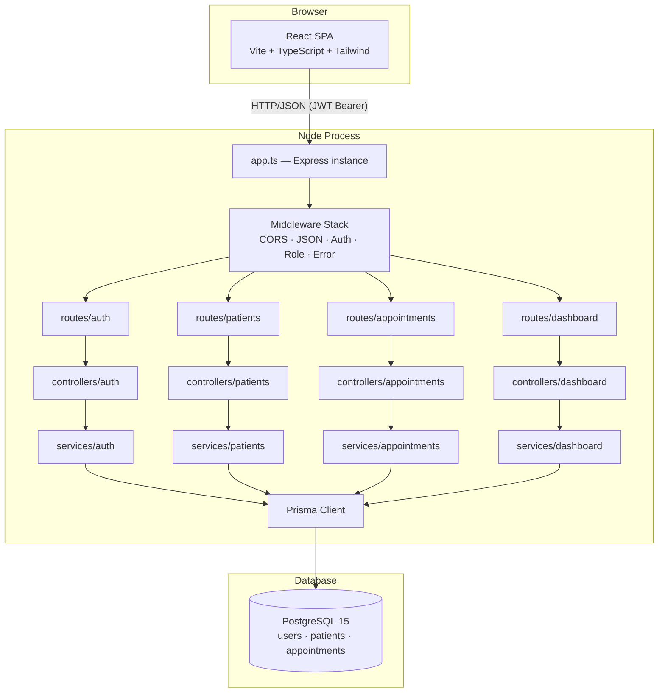
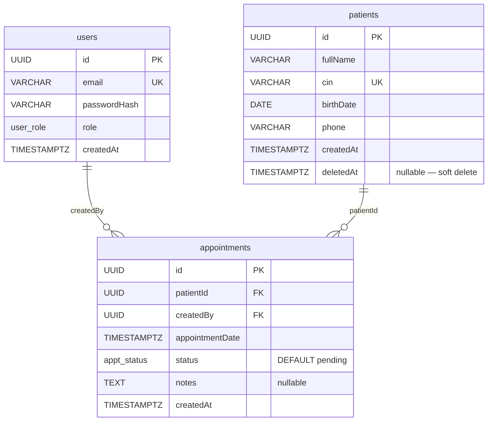

# Design Document — ClinicFlow (clinicflow-pern)

## Overview

ClinicFlow is a production-quality clinic management application built on the PERN stack (PostgreSQL, Express, React, Node.js) with TypeScript throughout. The system provides a RESTful API consumed by a React SPA, enforces JWT-based authentication with role-based access control (admin / staff), and implements business rules such as a 30-minute confirmed-appointment conflict window, paginated search, and soft-delete for patients.

### Key Design Goals

- **Layered backend**: strict routes → controllers → services → Prisma dependency direction; no cross-layer leakage.
- **Correctness by construction**: Zod validation gates every mutation before business logic is reached; the conflict rule is enforced inside a serializable database transaction.
- **Predictable error surface**: a single centralized error-handler middleware translates all thrown errors into a consistent JSON shape.
- **Stateless auth**: JWTs carry all identity/role data; no server-side session store is required.

---

## Architecture

### High-Level Component Diagram



### Runtime Separation

| Concern | Technology | Port |
|---|---|---|
| Backend API | Express + Node.js (TypeScript, ts-node-dev) | 5000 (configurable via `PORT`) |
| Frontend SPA | React + Vite (TypeScript) | 5173 (Vite default) |
| Database | PostgreSQL 15 | 5432 |

The backend exposes `app.ts` (the Express instance, for testing) separately from `server.ts` (the `app.listen()` entry point). This separation ensures the app can be imported into tests without binding a port.

---

## Components and Interfaces

### Backend Directory Structure

```
backend/
├── src/
│   ├── app.ts                  # Express instance, all middleware + routers registered
│   ├── server.ts               # calls app.listen(); process entry point
│   ├── prisma/
│   │   └── client.ts           # singleton PrismaClient export
│   ├── routes/
│   │   ├── auth.routes.ts
│   │   ├── patients.routes.ts
│   │   ├── appointments.routes.ts
│   │   └── dashboard.routes.ts
│   ├── controllers/
│   │   ├── auth.controller.ts
│   │   ├── patients.controller.ts
│   │   ├── appointments.controller.ts
│   │   └── dashboard.controller.ts
│   ├── services/
│   │   ├── auth.service.ts
│   │   ├── patients.service.ts
│   │   ├── appointments.service.ts
│   │   └── dashboard.service.ts
│   ├── middleware/
│   │   ├── auth.middleware.ts       # JWT verification → attaches req.user
│   │   ├── role.middleware.ts       # role guard factory
│   │   ├── validate.middleware.ts   # Zod validation factory
│   │   └── error.middleware.ts      # centralized error handler
│   ├── schemas/
│   │   ├── auth.schemas.ts
│   │   ├── patient.schemas.ts
│   │   └── appointment.schemas.ts
│   ├── types/
│   │   └── express.d.ts            # augments Express.Request with `user` field
│   └── utils/
│       ├── jwt.ts                  # sign / verify helpers
│       └── AppError.ts             # typed application error class
├── prisma/
│   ├── schema.prisma
│   ├── migrations/
│   └── seed.ts
├── .env
├── .env.example
└── tsconfig.json
```

### Frontend Directory Structure

```
frontend/
├── src/
│   ├── main.tsx
│   ├── App.tsx                     # router root, context providers
│   ├── api/
│   │   └── axios.ts                # Axios instance, request/response interceptors
│   ├── context/
│   │   └── AuthContext.tsx         # JWT storage, decoded user, login/logout
│   ├── hooks/
│   │   ├── useAuth.ts
│   │   └── useApi.ts               # generic loading/error wrapper
│   ├── pages/
│   │   ├── LoginPage.tsx
│   │   ├── DashboardPage.tsx
│   │   ├── PatientsListPage.tsx
│   │   ├── PatientDetailPage.tsx
│   │   └── AppointmentsPage.tsx
│   ├── components/
│   │   ├── layout/
│   │   │   ├── AppLayout.tsx       # sidebar + outlet
│   │   │   └── Sidebar.tsx
│   │   ├── shared/
│   │   │   ├── Spinner.tsx
│   │   │   ├── ErrorBanner.tsx
│   │   │   ├── Pagination.tsx
│   │   │   └── FieldError.tsx
│   │   ├── patients/
│   │   │   ├── PatientForm.tsx
│   │   │   └── PatientTable.tsx
│   │   └── appointments/
│   │       ├── AppointmentForm.tsx
│   │       ├── AppointmentTable.tsx
│   │       └── StatusBadge.tsx
│   ├── routes/
│   │   ├── ProtectedRoute.tsx      # redirects unauthenticated users
│   │   └── AdminRoute.tsx          # redirects non-admin users
│   └── types/
│       └── api.ts                  # shared TypeScript interfaces for API shapes
├── index.html
├── tailwind.config.ts
├── vite.config.ts
└── tsconfig.json
```

### Middleware Stack (app.ts registration order)

```
1. cors()                         — allow frontend origin
2. express.json()                 — parse JSON bodies
3. /api/auth     → authRouter     — public login route
4. authMiddleware                 — verify JWT on all routes below
5. /api/patients → patientRouter
6. /api/appointments → appointmentRouter
7. /api/dashboard → dashboardRouter
8. errorMiddleware                — 4-param Express error handler (last)
```

The auth router is registered **before** `authMiddleware` so that `POST /api/auth/login` remains public. All other routers are mounted after `authMiddleware`, so they inherit the authentication check.

### Zod Validation Middleware

```typescript
// middleware/validate.middleware.ts
import { ZodSchema } from 'zod';
import { Request, Response, NextFunction } from 'express';

export const validate =
  (schema: ZodSchema) =>
  (req: Request, res: Response, next: NextFunction) => {
    const result = schema.safeParse(req.body);
    if (!result.success) {
      const details = result.error.errors.map((e) => ({
        field: e.path.join('.'),
        message: e.message,
      }));
      return res.status(400).json({ error: 'Validation failed', details });
    }
    req.body = result.data;   // replace with parsed/coerced data
    next();
  };
```

### Centralized Error Handler

```typescript
// middleware/error.middleware.ts
import { Request, Response, NextFunction } from 'express';
import { AppError } from '../utils/AppError';

export const errorMiddleware = (
  err: unknown,
  req: Request,
  res: Response,
  next: NextFunction
) => {
  if (err instanceof AppError) {
    return res.status(err.statusCode).json({
      error: err.message,
      ...(err.details ? { details: err.details } : {}),
    });
  }
  console.error(err);
  res.status(500).json({ error: 'Internal server error' });
};
```

`AppError` carries a `statusCode`, a human-readable `message`, and an optional `details` array (for 400 validation failures forwarded from service layer). Controllers call `next(new AppError(409, '...'))` and the middleware handles the rest.

---

## Data Models

### Entity-Relationship Diagram



### Prisma Schema

```prisma
// prisma/schema.prisma
generator client {
  provider = "prisma-client-js"
}

datasource db {
  provider = "postgresql"
  url      = env("DATABASE_URL")
}

enum UserRole {
  admin
  staff
}

enum AppointmentStatus {
  pending
  confirmed
  cancelled
}

model User {
  id           String        @id @default(uuid())
  email        String        @unique
  passwordHash String
  role         UserRole      @default(staff)
  createdAt    DateTime      @default(now())
  appointments Appointment[] @relation("CreatedByUser")

  @@map("users")
}

model Patient {
  id           String        @id @default(uuid())
  fullName     String
  cin          String        @unique
  birthDate    DateTime      @db.Date
  phone        String
  createdAt    DateTime      @default(now())
  deletedAt    DateTime?

  appointments Appointment[]

  @@index([fullName])
  @@index([cin])
  @@map("patients")
}

model Appointment {
  id              String            @id @default(uuid())
  patientId       String
  createdBy       String?
  appointmentDate DateTime
  status          AppointmentStatus @default(pending)
  notes           String?
  createdAt       DateTime          @default(now())

  patient  Patient @relation(fields: [patientId], references: [id], onDelete: Cascade)
  creator  User?   @relation("CreatedByUser", fields: [createdBy], references: [id], onDelete: SetNull)

  @@index([appointmentDate])
  @@map("appointments")
}
```

### Column Constraints Summary

| Table | Column | Constraint |
|---|---|---|
| users | id | PK, UUID, default uuid() |
| users | email | UNIQUE, NOT NULL |
| users | passwordHash | NOT NULL |
| users | role | ENUM(admin, staff), NOT NULL, default staff |
| patients | id | PK, UUID, default uuid() |
| patients | cin | UNIQUE, NOT NULL |
| patients | fullName | NOT NULL; indexed |
| patients | cin | NOT NULL; indexed |
| patients | birthDate | DATE, NOT NULL |
| patients | deletedAt | NULLABLE timestamp (soft-delete) |
| appointments | id | PK, UUID, default uuid() |
| appointments | patientId | FK → patients.id ON DELETE CASCADE |
| appointments | createdBy | FK → users.id ON DELETE SET NULL, NULLABLE |
| appointments | appointmentDate | TIMESTAMPTZ, NOT NULL; indexed |
| appointments | status | ENUM(pending, confirmed, cancelled), default pending |

### Cascade Policies Rationale

- `appointments.patientId → patients.id ON DELETE CASCADE`: if a patient were ever hard-deleted, orphaned appointment rows must not remain.
- `appointments.createdBy → users.id ON DELETE SET NULL`: deleting a staff account should not cascade-delete patient appointments; historical records remain with `createdBy = NULL`.

---

## Appointment Conflict Rule Implementation

### Exact Conflict Window

For a new appointment with date **T** and patient **P**, a conflict exists when any existing `confirmed` appointment **T′** for patient **P** satisfies:

```
|T − T′| < 30 minutes
```

Translated to a half-open interval (exclusive boundaries at exactly 30 min):

```
T′ > T − 30min  AND  T′ < T + 30min
```

### Prisma Query for Conflict Check

```typescript
// Inside appointments.service.ts
const CONFLICT_WINDOW_MS = 30 * 60 * 1000; // 30 minutes

async function findConflict(
  patientId: string,
  appointmentDate: Date,
  excludeId?: string        // used when updating status to confirmed
) {
  const windowStart = new Date(appointmentDate.getTime() - CONFLICT_WINDOW_MS);
  const windowEnd   = new Date(appointmentDate.getTime() + CONFLICT_WINDOW_MS);

  return prisma.appointment.findFirst({
    where: {
      patientId,
      status: 'confirmed',
      appointmentDate: {
        gt: windowStart,   // strictly greater than T − 30 min
        lt: windowEnd,     // strictly less than T + 30 min
      },
      ...(excludeId ? { id: { not: excludeId } } : {}),
    },
  });
}
```

`gt` / `lt` (strict inequalities) implement boundary exclusion: appointments exactly 30 minutes apart (`|T − T′| = 30`) satisfy neither condition and are therefore **not** a conflict (Requirement 5.1).

### Concurrency-Safe Transaction

On `POST /api/appointments`:

```typescript
async function createAppointment(data: CreateAppointmentInput, userId: string) {
  return prisma.$transaction(async (tx) => {
    // Re-check conflict inside the transaction with a FOR UPDATE lock
    const conflict = await tx.appointment.findFirst({
      where: {
        patientId: data.patientId,
        status: 'confirmed',
        appointmentDate: {
          gt: new Date(data.appointmentDate.getTime() - CONFLICT_WINDOW_MS),
          lt: new Date(data.appointmentDate.getTime() + CONFLICT_WINDOW_MS),
        },
      },
    });
    if (conflict) {
      throw new AppError(409, `Conflicts with confirmed appointment at ${conflict.appointmentDate.toISOString()}`);
    }
    return tx.appointment.create({
      data: {
        patientId: data.patientId,
        appointmentDate: data.appointmentDate,
        notes: data.notes,
        createdBy: userId,
        status: 'pending',
      },
    });
  }, { isolationLevel: 'Serializable' });
}
```

Using `isolationLevel: 'Serializable'` ensures that two concurrent transactions reading the same patient's confirmed appointments cannot both see "no conflict" and then both insert; one will receive a serialization failure which Prisma surfaces as a `P2034` error, which the service layer catches and converts to HTTP 409.

### Status Update Conflict Check (Self-Exclusion)

```typescript
async function updateAppointmentStatus(id: string, newStatus: AppointmentStatus) {
  const appt = await prisma.appointment.findUnique({ where: { id } });
  if (!appt) throw new AppError(404, `Appointment with id ${id} not found`);

  if (newStatus === 'confirmed') {
    const conflict = await findConflict(appt.patientId, appt.appointmentDate, id);
    if (conflict) {
      throw new AppError(409, `Conflicts with confirmed appointment at ${conflict.appointmentDate.toISOString()}`);
    }
  }

  return prisma.appointment.update({ where: { id }, data: { status: newStatus } });
}
```

The `excludeId` parameter in `findConflict` prevents the appointment from conflicting with itself when being confirmed.

---

## API Contract

### Authentication

| Method | Path | Auth | Role | Request | Success | Errors |
|---|---|---|---|---|---|---|
| POST | /api/auth/login | No | — | `{ email, password }` | 200 `{ token, user: { id, email, role } }` | 400, 401 |
| GET | /api/auth/me | Yes | any | — | 200 `{ id, email, role }` | 401 |

### Patients

| Method | Path | Auth | Role | Request | Success | Errors |
|---|---|---|---|---|---|---|
| POST | /api/patients | Yes | any | Body: `{ fullName, cin, birthDate, phone }` | 201 patient object | 400, 409 |
| GET | /api/patients | Yes | any | Query: `page?`, `limit?`, `search?` | 200 `{ data: Patient[], total, page, limit, totalPages }` | 400, 401 |
| GET | /api/patients/:id | Yes | any | Path: `id` (UUID) | 200 patient object | 401, 404 |
| PUT | /api/patients/:id | Yes | any | Body: `{ fullName?, cin?, birthDate?, phone? }` | 200 updated patient | 400, 404, 409 |
| DELETE | /api/patients/:id | Yes | admin | Path: `id` | 200 `{ message: "Patient soft-deleted" }` | 401, 403, 404 |

### Appointments

| Method | Path | Auth | Role | Request | Success | Errors |
|---|---|---|---|---|---|---|
| POST | /api/appointments | Yes | any | Body: `{ patientId, appointmentDate, notes? }` | 201 appointment object | 400, 404, 409 |
| GET | /api/appointments | Yes | any | Query: `page?`, `limit?`, `date?` (YYYY-MM-DD), `status?` | 200 `{ data: Appointment[], total, page, limit, totalPages }` | 400, 401 |
| PATCH | /api/appointments/:id/status | Yes | any | Body: `{ status }` | 200 updated appointment | 400, 404, 409 |

### Dashboard

| Method | Path | Auth | Role | Request | Success | Errors |
|---|---|---|---|---|---|---|
| GET | /api/dashboard/stats | Yes | any | — | 200 `{ totalPatients, appointmentsToday, pendingCount, confirmedCount }` | 401 |

### Response Shape Reference

**Success (patient object)**:
```json
{
  "id": "uuid",
  "fullName": "Jane Doe",
  "cin": "AB123456",
  "birthDate": "1990-04-15",
  "phone": "+212600000000",
  "createdAt": "2024-01-01T10:00:00.000Z",
  "deletedAt": null
}
```

**Success (appointment object)**:
```json
{
  "id": "uuid",
  "patientId": "uuid",
  "createdBy": "uuid",
  "appointmentDate": "2024-06-01T09:00:00.000Z",
  "status": "pending",
  "notes": null,
  "createdAt": "2024-01-01T10:00:00.000Z"
}
```

**Error shape**:
```json
{ "error": "<message>" }
// or, on validation failure:
{ "error": "Validation failed", "details": [{ "field": "cin", "message": "Required" }] }
```

---

## Security Design

### Password Hashing Flow

```
Registration / Seed:
  plaintext → bcrypt.hash(plaintext, 10) → passwordHash stored in DB

Login:
  submitted plaintext + stored hash → bcrypt.compare() → boolean
  On false: throw AppError(401, "Invalid email or password")
```

Cost factor 10 is the minimum required by Requirement 1.6. bcrypt's output is self-describing (includes the salt), so no separate salt column is needed.

### JWT Flow

```
Sign (on login):
  payload: { sub: user.id, email: user.email, role: user.role }
  secret: process.env.JWT_SECRET
  options: { expiresIn: process.env.JWT_EXPIRES_IN }   // e.g. "24h"

Verify (auth middleware):
  header: Authorization: Bearer <token>
  jwt.verify(token, JWT_SECRET) → decoded payload
  req.user = { id: decoded.sub, email: decoded.email, role: decoded.role }
```

### Auth Middleware

```typescript
// middleware/auth.middleware.ts
export const authMiddleware = (req: Request, res: Response, next: NextFunction) => {
  const header = req.headers.authorization;
  if (!header?.startsWith('Bearer ')) {
    return res.status(401).json({ error: 'No token provided' });
  }
  try {
    const token = header.slice(7);
    const decoded = verifyToken(token);   // throws on expired/malformed
    req.user = decoded;
    next();
  } catch {
    return res.status(401).json({ error: 'Invalid or expired token' });
  }
};
```

### Role Middleware

```typescript
// middleware/role.middleware.ts
export const requireRole =
  (...roles: UserRole[]) =>
  (req: Request, res: Response, next: NextFunction) => {
    if (!req.user || !roles.includes(req.user.role)) {
      return res.status(403).json({ error: 'Forbidden' });
    }
    next();
  };

// Usage in routes:
router.delete('/:id', requireRole('admin'), patientsController.softDelete);
```

### Input Sanitization via Zod

All mutation endpoints use `validate(schema)` middleware. Zod schemas define:
- Required vs optional fields
- String trimming (`.trim()`)
- `birthDate` validated as `z.string().regex(/^\d{4}-\d{2}-\d{2}$/)` to enforce date-only format
- `appointmentDate` validated as `z.string().datetime()` for ISO 8601
- `status` validated as `z.enum(['pending', 'confirmed', 'cancelled'])`

After validation, `req.body` is replaced with the parsed (coerced) Zod output, so downstream service functions receive only typed, validated data.

---

## Frontend Architecture

### Routing Strategy

```tsx
// App.tsx
<BrowserRouter>
  <AuthProvider>
    <Routes>
      <Route path="/login" element={<LoginPage />} />
      <Route element={<ProtectedRoute />}>
        <Route element={<AppLayout />}>
          <Route path="/dashboard" element={<DashboardPage />} />
          <Route path="/patients" element={<PatientsListPage />} />
          <Route path="/patients/:id" element={<PatientDetailPage />} />
          <Route path="/appointments" element={<AppointmentsPage />} />
        </Route>
      </Route>
      <Route path="*" element={<Navigate to="/dashboard" />} />
    </Routes>
  </AuthProvider>
</BrowserRouter>
```

`ProtectedRoute` checks `AuthContext` — if no valid token exists, it redirects to `/login`. `AppLayout` renders the Sidebar and an `<Outlet />`.

### Auth Context

```typescript
interface AuthContextValue {
  user: { id: string; email: string; role: 'admin' | 'staff' } | null;
  token: string | null;
  login: (token: string) => void;   // decodes JWT, stores in localStorage
  logout: () => void;               // clears localStorage, resets state
}
```

On mount, `AuthProvider` reads `localStorage.getItem('token')`, decodes the payload with `jwt-decode`, checks the `exp` claim, and populates state. Role-gating in the UI is done by reading `user.role` from context.

### Axios Instance & Interceptors

```typescript
// api/axios.ts
const api = axios.create({ baseURL: '/api' });

// Request: attach JWT
api.interceptors.request.use((config) => {
  const token = localStorage.getItem('token');
  if (token) config.headers.Authorization = `Bearer ${token}`;
  return config;
});

// Response: 401 → logout
api.interceptors.response.use(
  (res) => res,
  (error) => {
    if (error.response?.status === 401) {
      localStorage.removeItem('token');
      window.location.href = '/login';
    }
    return Promise.reject(error);
  }
);
```

### Form Handling & Validation Error Display

Forms use React controlled inputs. On submission:
1. Call `api.post/put(...)`.
2. On HTTP 400 with `details[]`, map `details` to a `Record<string, string>` by `field` name.
3. Render `<FieldError>` adjacent to each field using the mapped errors.
4. Render `<ErrorBanner>` at the top with a summary (e.g., "2 errors — see highlighted fields").
5. Details whose `field` key does not match any form field are shown only in the banner.

### Loading & Error State Pattern

A custom `useApi` hook wraps all calls:

```typescript
const { data, loading, error, execute } = useApi(() => api.get('/patients'));
```

- While `loading` is true, the page renders `<Spinner />`.
- On `error`, `<ErrorBanner>` is shown.
- `error` is cleared on the next `execute()` call.

### Role-Based UI

```tsx
const { user } = useAuth();

{user?.role === 'admin' && (
  <button onClick={() => handleDelete(patient.id)} className="...">Delete</button>
)}
```

The delete button and user management controls are conditionally rendered based on `user.role`.

---

## Error Handling

### AppError Class

```typescript
export class AppError extends Error {
  constructor(
    public statusCode: number,
    message: string,
    public details?: { field: string; message: string }[]
  ) {
    super(message);
  }
}
```

Services throw `AppError` instances for all expected error conditions (404, 409, 403). Unexpected errors propagate as-is to the error middleware, which returns 500.

### HTTP Status Code Mapping

| Condition | Status | Body |
|---|---|---|
| Zod validation failure | 400 | `{ error: "Validation failed", details: [...] }` |
| Bad credentials | 401 | `{ error: "Invalid email or password" }` |
| Missing/invalid JWT | 401 | `{ error: "No token provided" }` or `{ error: "Invalid or expired token" }` |
| Insufficient role | 403 | `{ error: "Forbidden" }` |
| Resource not found | 404 | `{ error: "<Type> with id <id> not found" }` |
| Conflict (CIN / appointment) | 409 | `{ error: "<reason>" }` |
| Unhandled exception | 500 | `{ error: "Internal server error" }` |

---

## Correctness Properties

*A property is a characteristic or behavior that should hold true across all valid executions of a system — essentially, a formal statement about what the system should do. Properties serve as the bridge between human-readable specifications and machine-verifiable correctness guarantees.*

### Property 1: Appointment Conflict Rejection

*For any* patient P and any two `confirmed` appointments with dates T and T′ where |T − T′| < 30 minutes, the system SHALL reject the creation or confirmation of the second appointment with HTTP 409, and the database SHALL contain at most one confirmed appointment in that 30-minute window for patient P.

**Validates: Requirements 5.1, 5.2, 5.3, 5.4**

### Property 2: Appointment Conflict Boundary Acceptance

*For any* patient P and any confirmed appointment at date T, an appointment at date T + 30 minutes (exactly) SHALL be accepted — i.e., a gap of exactly 30 minutes is NOT a conflict.

**Validates: Requirements 5.1**

### Property 3: Soft-Delete Visibility Exclusion

*For any* patient P that has been soft-deleted, no API response from `GET /api/patients`, `GET /api/patients?search=...`, or `GET /api/patients/:id` SHALL include patient P's data.

**Validates: Requirements 3.5, 3.12, 9.9**

### Property 4: Pagination Result Bound

*For any* paginated list request with `limit = L` and `page = N`, the `data` array in the response SHALL contain at most `L` records.

**Validates: Requirements 3.9, 4.8**

### Property 5: Invalid JWT Rejection

*For any* request bearing a JWT that is either malformed, signed with the wrong secret, or past its `exp` timestamp, the Auth_Middleware SHALL return HTTP 401 and the request SHALL NOT reach any route handler.

**Validates: Requirements 1.3, 1.4**

### Property 6: Role Guard Enforcement

*For any* request to an admin-only endpoint (`DELETE /api/patients/:id`, any `/api/users` endpoint) made by an authenticated user with role `staff`, the Role_Middleware SHALL return HTTP 403 before any service or database call is made.

**Validates: Requirements 2.1, 2.2, 2.3**

---

## Testing Strategy

### Dual Testing Approach

Both unit/integration tests and property-based tests are used together:

- **Unit / integration tests**: verify specific examples, edge cases, and error conditions (e.g., "login with wrong password returns 401", "creating a patient with a duplicate CIN returns 409").
- **Property-based tests**: verify universal properties that should hold across a wide range of generated inputs (the six properties listed above).

### Property-Based Testing Library

**Backend (Node.js/TypeScript)**: [fast-check](https://github.com/dubzzz/fast-check)

```bash
npm install --save-dev fast-check
```

Each property-based test runs a minimum of **100 iterations**. Each test is tagged with a comment identifying its property:

```typescript
// Feature: clinicflow-pern, Property 1: Appointment Conflict Rejection
it('rejects any second confirmed appointment within 30-minute window', () => {
  fc.assert(
    fc.asyncProperty(fc.date(), fc.integer({ min: 1, max: 29 }), async (baseDate, offsetMinutes) => {
      // ...
    }),
    { numRuns: 100 }
  );
});
```

### Unit Test Focus

- Auth service: login success/failure, JWT sign/verify, bcrypt round-trip.
- Patient service: create, update (CIN conflict), soft-delete, pagination offsets, search filtering.
- Appointment service: conflict window edge cases (29 min, 30 min, 31 min), status transitions.
- Validation middleware: Zod rejection for each schema, field-level error shapes.
- Error middleware: AppError → correct status code and body mapping.

### Integration Test Focus

- Full HTTP round-trips using `supertest` against the Express app.
- Auth flow: login → token → protected route.
- Role enforcement: staff attempting delete returns 403.
- Concurrent appointment creation: two simultaneous POSTs for overlapping slots.

### Property Test Configuration

| Property | Generators | Invariant |
|---|---|---|
| P1 — Conflict rejection | `fc.date()`, `fc.integer({min:1,max:29})` (offset in minutes) | Second confirmed appointment is rejected |
| P2 — Boundary acceptance | `fc.date()` | Appointment exactly 30 min later is accepted |
| P3 — Soft-delete visibility | `fc.record({...patient fields})` | Deleted patient absent from all list/search/detail |
| P4 — Pagination bound | `fc.integer({min:1,max:100})` (limit), `fc.integer({min:1})` (page) | `data.length <= limit` |
| P5 — Invalid JWT | `fc.string()` (random tokens), `fc.date()` (expired dates) | Always returns 401 |
| P6 — Role guard | `fc.constantFrom('staff')` | Always returns 403 on admin-only endpoints |
